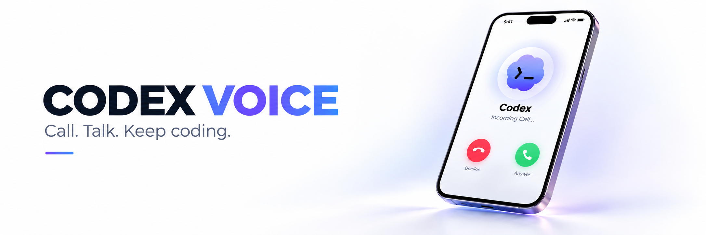
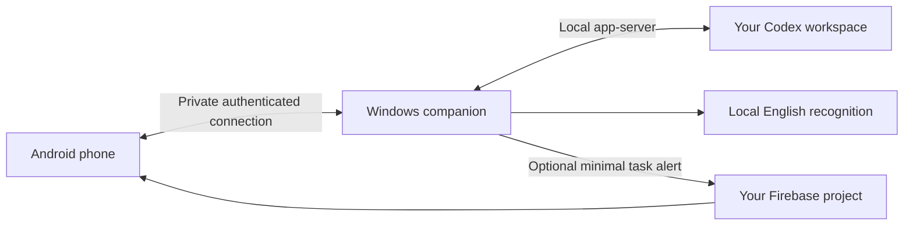

# Codex Voice

**Your Codex workspace, within reach.**

A Windows desktop companion and native Android app for following Codex work, sending instructions, and talking to your workspace over a private connection.

## The idea

Coding work happens on your PC, but you do not always need to be sitting in front of it. Codex Voice brings your selected workspace to your phone: ask for an update, send a short instruction, hear the response, and return to your day. Your PC remains in charge of the project and its execution approvals.

Each installation belongs to its user. Sign-in, project selection, private networking, notification configuration, and phone pairing are saved on your devices. There is no shared developer account, hardcoded private endpoint, or hosted control server to depend on.

## Work from your phone

- **Talk or type.** Call Codex, review recognized instructions, or use the text conversation screen.
- **Stay informed.** Follow progress and results from your selected local Codex conversation. Optional task alerts can offer an incoming audio call.
- **Keep control.** Choose the project on your PC. Review execution approvals, revoke a paired phone, or stop the companion at any time.
- **Keep speech local.** English recognition runs on the PC with whisper.cpp; spoken responses use an offline Android voice.
- **Make it yours.** Native light and dark themes, compact settings, clear call controls, and your own device configuration.

Codex Voice uses the supported local Codex app-server and your existing eligible ChatGPT login. It does not require an OpenAI API key or add API billing. Your normal Codex plan limits still apply. This is an independent community project, not an official OpenAI application.

## Get started

You need a Windows x64 PC, Android 12 or later, an eligible Codex account, and Tailscale on both devices. Optional background alerts use your own Firebase Spark project with billing unlinked.

1. Build the desktop and Android apps using the [build guide](docs/BUILDING.md).
2. In **Set up this PC**, use **Sign in to Codex**, open Tailscale, and select **Set up private connection**.
3. Choose a project and follow [device setup](docs/SETUP.md) to pair your phone. Import your own Firebase configuration in each app if you want background task alerts.
4. Open the desktop companion and select **Start Companion**. On Android, use **Call Codex** or **Text Codex**.

There is no preconfigured shared backend or account. Credentials, Firebase configuration, project folders, and pairing are set up locally. No prebuilt public downloads are supplied by this source release.

## From instruction to result

1. **Choose the workspace.** Select your project and Codex conversation on Windows. Coding authorization is an explicit choice.
2. **Connect your phone.** Both devices join your private Tailscale network; a short-lived invitation pairs the Android app.
3. **Talk or type.** Text goes through the authenticated companion connection. During an answered call, audio goes to local English speech recognition on your PC.
4. **Review and send.** Review the instruction or use the optional short auto-send countdown with Cancel/Edit. Codex receives it in the selected conversation, under its existing permissions.
5. **Follow the outcome.** Progress and responses return to the phone. Offline speech can read responses aloud; optional task alerts can offer an incoming call.
6. **Stay in control.** Hang up to end audio, revoke a paired phone, or use Stop all to end the companion's owned services.

## Technology

| Component | Technology | Role |
| --- | --- | --- |
| Windows app | Electron, HTML/CSS, JavaScript | Desktop controls, local setup, project selection, approvals, tray lifecycle |
| Companion bridge | Node.js 24, TypeScript | Owned Codex process, validated messages, conversation state and call coordination |
| Codex integration | Pinned Codex 0.160.0 app-server | Supported local protocol and existing ChatGPT sign-in |
| Android app | Kotlin, Jetpack Compose, Material 3 | Native light/dark interface, settings, conversations and call screens |
| Private connection | Tailscale Serve, HTTPS/WSS, OkHttp | Private network transport plus independent application pairing |
| Calling | Android Core-Telecom, foreground audio services | Incoming-call integration, microphone consent and audio routing |
| Speech | whisper.cpp tiny.en, offline Android TTS | Local English recognition and spoken responses |
| Optional alerts | Firebase Cloud Messaging and Admin SDK | Minimal signed task events through your own project |
| Protected device state | Windows DPAPI, Android Keystore | Pairing and other protected local device records |

## Private by design

The desktop owns the Codex process. A narrow authenticated protocol connects the phone through private Tailscale HTTPS; the privileged app-server is never exposed to the network. New companion-managed work starts read-only, with explicit project write authorization and Codex approvals. Observed original conversations retain their original client's permissions.

Microphone capture starts only after an explicit call action and Android permission. Firebase alerts carry minimal signed event data; task details are retrieved from the authenticated PC. Local Codex work still communicates with OpenAI through the signed-in account.

Read [security and privacy](docs/SECURITY_AND_PRIVACY.md) for storage, trust boundaries, and practical limits.

## What to expect

Incoming-call presentation depends on Android settings, notification permissions, the device manufacturer, and background restrictions. Android may show a banner while you use another app. Push delivery and reconnection depend on connectivity and the operating system. Recognition currently supports English, with half-duplex speech playback.

Setup is retained across ordinary app restarts and same-signature Android updates. Clearing app storage, revoking a device, or switching Firebase projects can require setup and pairing again. Keeping an account permanently authorized is subject to the sign-in provider's session rules.

A completed Codex turn means the turn finished; it is not a guarantee that its changes or commands succeeded. Explicit demo mode is simulated and keeps the microphone off.

## Development and validation

This repository preserves **70 genuine development commits** from the product's earlier private development, with personal metadata and private setup reports removed. The history shows the bridge, Android client, pairing, notifications, calls, local speech, conversation controls and desktop setup evolving over time. It is not an artificial break-and-fix reconstruction.

Retained historical outputs show **150 bridge tests passed** and **94 Android unit tests passed, with one skipped case**, alongside separate native acceptance evidence. These results belong to earlier revisions. **No tests or device installations were performed for this publication.** See [historical validation evidence](docs/VALIDATION_HISTORY.md) for suite growth, discrepancies in written reports, failures and limitations.

## Documentation

- [Setup](docs/SETUP.md)
- [Build from source](docs/BUILDING.md)
- [Troubleshooting](docs/TROUBLESHOOTING.md)
- [Architecture](docs/ARCHITECTURE.md)
- [Security and privacy](docs/SECURITY_AND_PRIVACY.md)
- [Historical validation evidence](docs/VALIDATION_HISTORY.md)

## License

Codex Voice source is available under the [MIT License](LICENSE). Bundled or downloaded dependencies retain their own licenses; see [third-party notices](docs/licenses/THIRD_PARTY.md).
