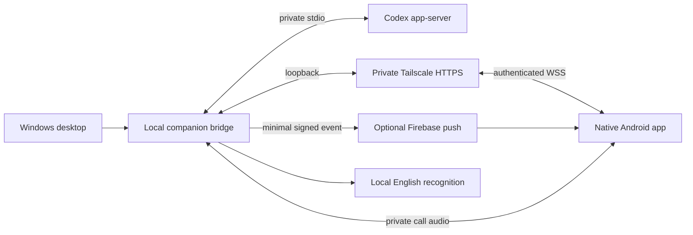

# Architecture

The desktop renderer has a narrow validated IPC interface. It cannot call raw Codex RPC or spawn commands. The desktop starts one owned worker tree, which verifies ChatGPT authentication and configuration, manages conversations, and serves a bounded authenticated phone protocol on loopback.

The Codex transport uses newline-delimited JSON over private stdio. Each local response frame is bounded to 32 MiB because original conversation histories can be large. Remote phone messages retain their separate smaller limits; raw local frames are never forwarded.

Stored conversations can be observed without taking ownership. Instructions for a conversation owned by another Codex client enter its native user-message queue. Companion-managed conversations use the bridge's explicit project policy. Unknown outcomes are not automatically replayed.

Android uses Compose, a serialized remote client, Android Keystore for pairing, self-managed Telecom calls, and visible foreground services for microphone/media sessions. Explicit consent precedes capture. Offline TTS and local PC recognition provide half-duplex English speech.

Project selection, Firebase identifiers, notification preferences, credentials, reviewer keys and histories are local state. The public repository contains source, documentation, generic fixtures and pinned dependency definitions. There is no shared configured account or public control server.
